# Installation de rhel9-lab et ubuntu24-lab

## 1 Périmètre

**Groupe :** TETA KENGNE Joy Adjovi ; Vladimir MELTSOV ; Mankchould LAWAL.

Ce rapport présente l’installation et le premier durcissement de serveurs RHEL 9 et Ubuntu Server 24.04 LTS : stockage LVM, configuration système, comptes d’administration, accès SSH et filtrage réseau. Deux environnements indépendants, A et B, comprennent chacun les machines rhel9-lab et ubuntu24-lab. Ces repères distinguent les configurations et les relevés sans modifier les noms d’hôte.

| Élément relevé | RHEL A | Ubuntu A | RHEL B | Ubuntu B |
|---|---|---|---|---|
| Nom d'hôte | rhel9-lab | ubuntu24-lab | rhel9-lab | ubuntu24-lab |
| Distribution | RHEL 9.8 Plow | Ubuntu 24.04.5 LTS | RHEL 9.8 Plow | Ubuntu 24.04.5 LTS |
| Noyau affiché | 5.14.0-687.54.1.el9_8 | 6.8.0-147-generic | 5.14.0-687.57.1.el9_8 | 6.8.0-147-generic |
| Compte visible | vlad | vlad | joy et alice | joy et alice |
| Dernier relevé daté | 25 octobre 2026 | 25 octobre 2026 | 22 octobre 2026 | 22 octobre 2026 |

Les tableaux présentent les résultats des relevés du 25 octobre pour A et du 22 octobre pour B. Les captures montrent également les étapes de l’installation.

### Questions de préparation

**Distribution et noyau.** Le noyau gère le processeur, la mémoire, les périphériques et les appels système. Une distribution assemble ce noyau avec les outils utilisateurs, le gestionnaire de paquets, les services et leurs paramètres. RHEL et Ubuntu utilisent Linux, avec des versions et des outils d'administration différents.

**Contenu de /etc/fstab.** Ce fichier décrit les montages persistants : source du système de fichiers, point de montage, type, options et paramètres de vérification. Une entrée de swap y décrit aussi l'espace d'échange. Une erreur peut empêcher un montage au démarrage ; il faut contrôler sa syntaxe et tester les montages avant de redémarrer.

**Volume logique.** Un LV est un espace de stockage créé dans un groupe de volumes LVM. Le groupe est alimenté par un ou plusieurs volumes physiques. Le système de fichiers est créé sur le LV, qui est ensuite monté à l'endroit choisi.

**Accès distant root.** Un compte personnel permet d'identifier l'administrateur. Les privilèges sont obtenus ponctuellement avec sudo. Le mot de passe root est verrouillé et sa connexion SSH directe est refusée.

## 2 Ressources et préparation des machines

### A1 à A4 - Hyperviseur, réseau et instantanés

Les captures VMware montrent deux vCPU et 2 Gio de mémoire par VM. Le poste hôte de l’environnement B montre la virtualisation matérielle activée dans le gestionnaire des tâches. Dans l’environnement A, les deux VM disposent d'une carte NAT et d'une seconde carte sur VMnet2. L’environnement B utilise VMnet1 pour son réseau de laboratoire et VMnet8 pour le NAT.

| Paramètre | RHEL A | Ubuntu A | RHEL B | Ubuntu B |
|---|---|---|---|---|
| Hyperviseur | VMware Workstation | VMware Workstation | VMware Workstation | VMware Workstation |
| vCPU et mémoire | 2 et 2 Gio | 2 et 2 Gio | 2 et 2 Gio | 2 et 2 Gio |
| Disque système | 30 Gio | 25 Gio | 42 Gio | 25 Gio |
| NAT IPv4 | ens160 : 192.168.198.128/24 | ens33 : 192.168.198.129/24 | ens160 : 192.168.43.129/24 | ens33 : 192.168.43.128/24 |
| Carte laboratoire | ens192 UP, sans IPv4 affichée | ens34 DOWN, sans IPv4 | ens224 : 10.42.0.11/24 | ens37 : 10.42.0.12/24 |
| Instantané avant installation | avant-installation visible | avant-installation visible | Preuve non jointe | Preuve non jointe |

L'instantané avant-installation permet de retrouver la configuration de la VM avant l'écriture du système. Il évite de recréer les ressources et les cartes réseau si l'installation doit être reprise. Le réseau du laboratoire est isolé ; le mode pont n'est pas utilisé. Le NAT sert aux dépôts et aux mises à jour.

Les interfaces de laboratoire de l’environnement A doivent encore recevoir leurs paramètres IPv4. Les adresses prévues sont 10.42.0.11/24 pour RHEL et 10.42.0.12/24 pour Ubuntu, sur son réseau isolé. Les mêmes adresses existent dans le laboratoire indépendant de l’environnement B.

Pour préparer une nouvelle VM : vérifier la virtualisation, créer les ressources indiquées, attacher l'ISO, ajouter NAT et réseau interne, puis prendre l'instantané avant-installation. Après l'installation, retirer l'ISO ou faire passer le disque avant le lecteur optique. Si une somme SHA-256 de référence est fournie avec l'ISO, la comparer au résultat de `Get-FileHash -Algorithm SHA256` sous PowerShell. Aucune comparaison d'empreinte n'est attestée dans les captures.

### Captures

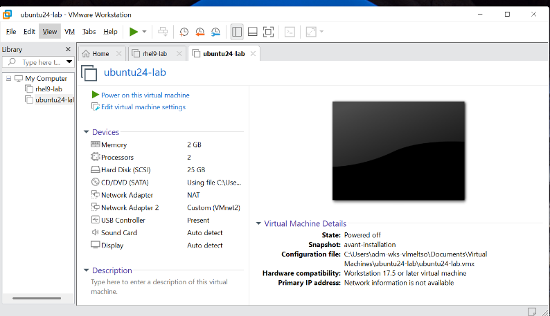

Figure 1 - Deux vCPU, 2 Gio de RAM, disque de 25 Gio, NAT, VMnet2 et instantané avant-installation. (A2-A4)

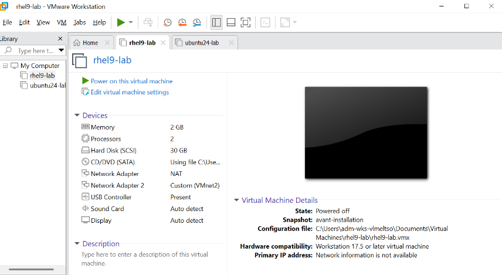

Figure 2 - Deux vCPU, 2 Gio de RAM, disque de 30 Gio, NAT, VMnet2 et instantané avant-installation. (A2-A4)

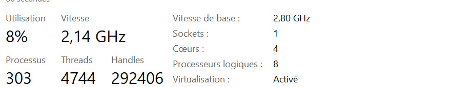

Figure 3 - Le gestionnaire des tâches indique que la virtualisation est activée sur le poste hôte B. (A1)

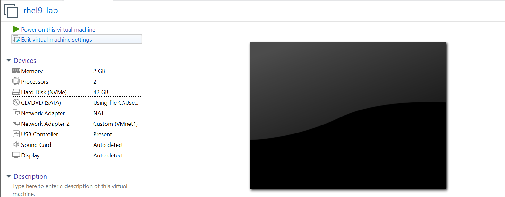

Figure 4 - Deux vCPU, 2 Gio de RAM, disque NVMe de 42 Gio, carte NAT et carte VMnet1. (A2-A3)

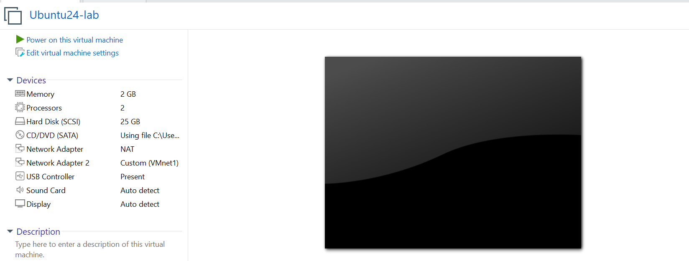

Figure 5 - Deux vCPU, 2 Gio de RAM, disque de 25 Gio et deux cartes réseau. (A2-A3)

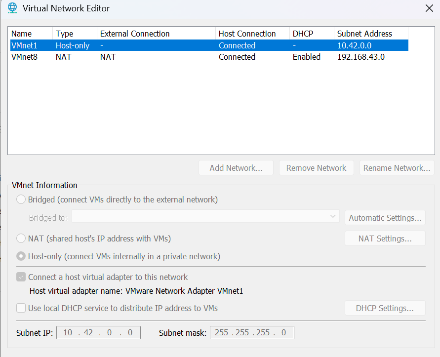

Figure 6 - VMnet1 en host-only sur 10.42.0.0/24 ; VMnet8 en NAT sur 192.168.43.0/24. (A3)


## 3 Partitionnement appliqué

### B2 - Partitionnement de l’environnement A

| Volume ou partition | RHEL taille et type | Ubuntu taille et type | Montage |
|---|---|---|---|
| Partition EFI | sda1 : 600 Mio, vfat | Sans partition EFI affichée | /boot/efi sur RHEL |
| Partition de démarrage | sda2 : 1 Gio, xfs | sda2 : 1 Gio, ext4 | /boot |
| Volume physique | sda3 : 27 Gio | sda3 : 24 Gio affichés | Membre LVM |
| lv_root | 10 Gio, xfs | 10 Gio, ext4 | / |
| lv_var | 5 Gio, xfs | 5 Gio, ext4 | /var |
| lv_log | 2,5 Gio, xfs | 2,5 Gio, ext4 | /var/log |
| lv_home | 2,5 Gio, xfs | 2,5 Gio, ext4 | /home |
| Swap | lv_swap : 2 Gio | swap : 2 Gio | [SWAP] |
| Groupe vg_sys | 27 Gio ; 5 Gio libres | Moins de 24 Gio ; moins de 2 Gio libres | Réserve LVM |

La partition Ubuntu sda1 de 1 Mio apparaît sans système de fichiers. Les noms du tableau sont ceux du dernier lsblk ; le LV de swap Ubuntu se nomme `swap`. La réserve est vérifiée avec vgs, et non avec la seule place disponible dans un système de fichiers. Les exports directs du 25 octobre confirment les noms, tailles et montages de ce tableau.

### B2 - Partitionnement de l’environnement B

| Volume ou partition | RHEL taille et type | Ubuntu taille et type | Montage |
|---|---|---|---|
| Partition EFI | nvme0n1p1 : environ 512 Mio, vfat | Sans partition EFI affichée | /boot/efi sur RHEL |
| Partition de démarrage | nvme0n1p2 : environ 1 Gio, xfs | sda2 : environ 1 Gio, ext4 | /boot |
| Racine | lv_root : 18 Gio, xfs | lv-root : 12 Gio, ext4 | / |
| Données variables | lv_var : 10 Gio, xfs | lv-var : 4 Gio, ext4 | /var |
| Journaux | var_log : 5 Gio, xfs | lv-loh : 2 Gio, ext4 | /var/log |
| Répertoires personnels | lv_home : 5 Gio, xfs | lv-home : 1 Gio, ext4 | /home |
| Swap | lv_swap : 2 Gio | lv-swap : 2 Gio | [SWAP] |
| Groupe vg_sys | 40 Gio ; 0 libre | Moins de 24 Gio ; moins de 3 Gio libres | Réserve LVM |
| tmpfs | Sans montage spécifique demandé | 512 Mio | /tmp sur Ubuntu |

Les tailles du second tableau proviennent de df et vgs ; les tailles de partitions d'amorçage sont arrondies. Le LV Ubuntu `lv-loh` est bien monté sur /var/log malgré son nom. Le groupe RHEL de l’environnement B n'a pas de réserve au relevé du 22 octobre ; la réserve doit être rétablie avant une extension de LV.

### B1 Justification des choix

**1 Séparer /var et /var/log.** /var reçoit des données variables : caches, files d'attente et données de services. /var/log contient les journaux. Un service en boucle peut écrire des gigaoctets de messages. Si ces journaux partagent le volume racine, ils peuvent empêcher la création de fichiers système et perturber plusieurs services. Un volume séparé limite cette saturation à l'usage concerné ; il faut ensuite surveiller l'espace et organiser la rotation des journaux.

**2 Conserver /boot hors LVM.** /boot contient les noyaux et les images nécessaires au démarrage. Une partition classique simplifie l'amorçage et le dépannage, en limitant les dépendances à la configuration LVM. Cela ne signifie pas que tout chargeur d'amorçage est incapable de lire LVM. Sur les VM RHEL en UEFI, une partition EFI en vfat complète /boot.

**3 Choisir 2 Gio de swap pour 2 Gio de RAM.** La swap constitue une marge pour les pages mémoire peu utilisées et les pointes temporaires de consommation. Sans swap, une pression mémoire peut provoquer plus vite l'arrêt de processus par le noyau. Réserver 8 Gio n'apporte pas davantage de RAM et utilise plus de disque ; des échanges intensifs ralentissent la VM. Les 2 Gio retenus correspondent à l'usage léger du laboratoire, sans objectif d'hibernation.

**4 Garder de l'espace dans le groupe.** L'espace non affecté à un LV pourra être attribué au volume qui manque de place, sans réinstaller le serveur. Il peut aussi servir à certains instantanés LVM. Il faut distinguer cette réserve, affichée par vgs, de l'espace encore libre à l'intérieur de / ou /var.

**5 Volume susceptible de croître et opération à maîtriser.** /var/log est un candidat probable, car les journaux s'accumulent. /var peut aussi croître selon les applications. L'agrandissement repose sur l'extension du LV puis celle du système de fichiers, en ligne lorsque celui-ci le permet. Pour XFS on utilise xfs_growfs ; pour ext4, resize2fs. `lvextend -r` peut réaliser les deux étapes. Le nom du LV doit correspondre à la machine concernée et la réserve du groupe doit être vérifiée avant l'opération.

### B2 et B3 Application et contrôle

Dans Anaconda et Subiquity, sélectionner le partitionnement manuel, créer les partitions d'amorçage, le volume physique, vg_sys puis les LV avec leurs points de montage. Vérifier le tableau avant l'écriture. Le contrôle du schéma par l'enseignant intervient avant validation de l'installateur.

```bash
lsblk -f
lsblk -o NAME,SIZE,TYPE,FSTYPE,MOUNTPOINTS
df -hT
sudo vgs
swapon --show
findmnt --target /var/log
```

Dans l’environnement A, les deux sorties montrent les cinq LV et une swap de 2 Gio active. Les exports du 25 octobre confirment les réserves LVM. Dans l’environnement B, les fichiers de preuves distinguent les états RHEL et Ubuntu et conservent les noms réels des volumes.

### Captures

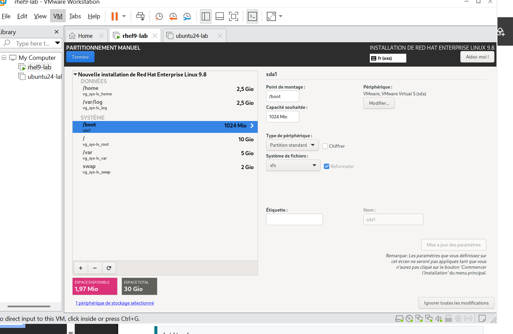

Figure 7 - Partitionnement manuel dans Anaconda. Les tailles définitives figurent dans le tableau et les relevés du 25 octobre. (B2)

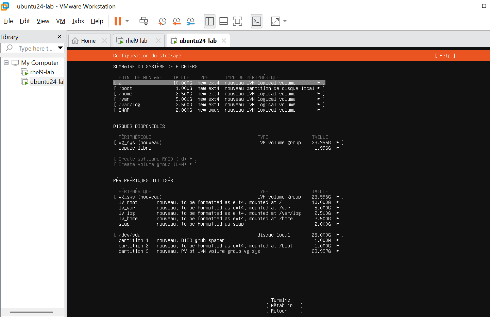

Figure 8 - Création des points de montage et du groupe vg_sys dans Subiquity. (B2)

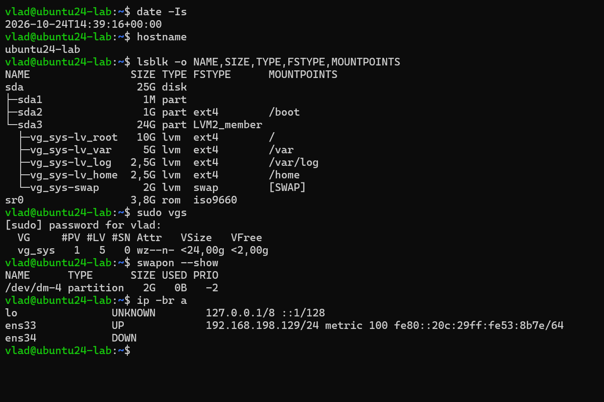

Figure 9 - Swap active de 2 Gio, réserve LVM inférieure à 2 Gio et interface ens34 inactive. (B3/E)

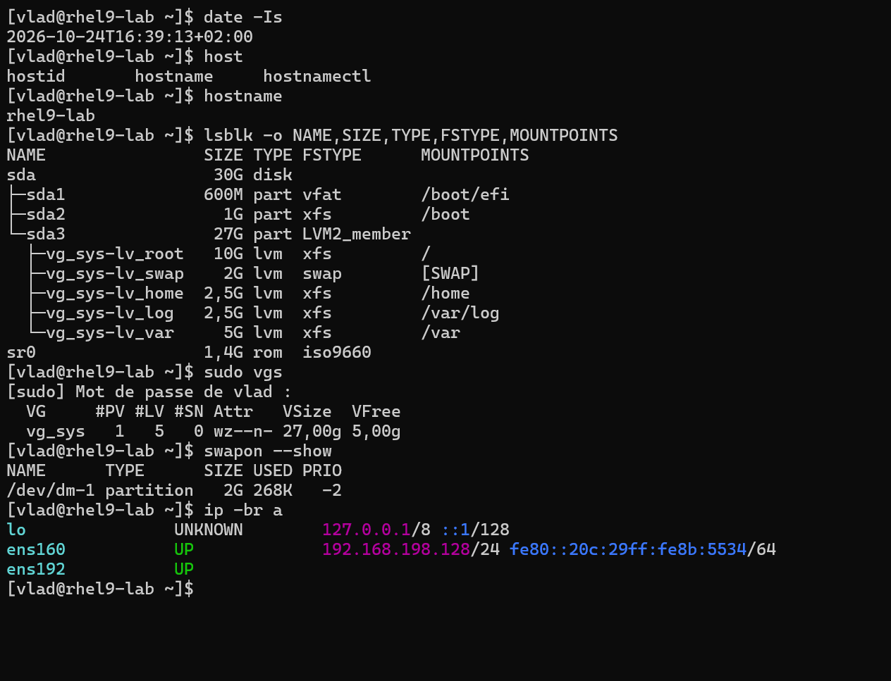

Figure 10 - Cinq LV, swap active de 2 Gio et réserve de 5 Gio. ens192 est active sans adresse IPv4 affichée. (B3/E)

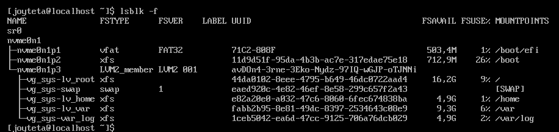

Figure 11 - Les LV de vg_sys séparent /, /var, /var/log, /home et la swap. (B3)

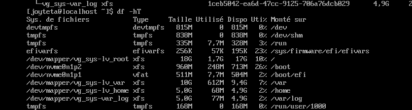

Figure 12 - df -hT expose les tailles des systèmes de fichiers et leurs points de montage. (B3)

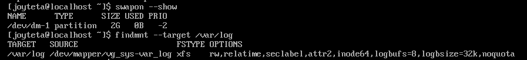

Figure 13 - findmnt confirme le montage XFS séparé de /var/log sur le LV var_log. (B3)


## 4 Installation et configuration de base

### C1 et C2 - Profil minimal et identité

Le profil retenu est celui d'un serveur sans environnement de bureau. RHEL utilise Anaconda ; Ubuntu Server utilise Subiquity. Définir les noms rhel9-lab et ubuntu24-lab, puis créer un compte personnel. Les paquets de bureau ne sont pas nécessaires. L'historique contient une installation de open-vm-tools-desktop ; pour reconstruire un serveur minimal, open-vm-tools seul suffit aux fonctions invitées courantes de VMware.

```bash
hostnamectl
cat /etc/os-release
uname -r
systemctl --failed --no-pager
systemctl list-units --type=service --state=running
```

### C3 Locale et horloge

| Contrôle | RHEL A | Ubuntu A | RHEL B | Ubuntu B |
|---|---|---|---|---|
| LANG affiché | fr_FR.UTF-8 | fr_FR.UTF-8 | fr_FR.UTF-8 | C.UTF-8 |
| fr_FR disponible | Oui | Oui | Oui | Pas de résultat dans la capture |
| Fuseau affiché | Europe/Paris | Etc/UTC | Europe/Paris | Europe/Paris |
| Synchronisation NTP | Oui, active | Oui, active | Oui, active | Oui, active |
| Unités en échec | Aucun à 11:07 ; NetworkManager-wait-online à 11:08 | Aucune | Aucune | Aucune |
| /tmp Ubuntu | Sans exigence tmpfs RHEL | Dans la racine ext4 | Sans exigence tmpfs RHEL | tmpfs 512 Mio |

L'horloge Ubuntu de l’environnement A est synchronisée mais son fuseau est UTC : l'heure absolue est correcte, tandis que la présentation locale demandée reste à régler. Sa locale française est maintenant bien disponible. Le montage de /tmp doit encore être réalisé sur cette VM. Le RHEL de l’environnement A présente une unité en échec au dernier contrôle ; l'absence d'erreur dans une capture plus ancienne ne remplace pas ce constat.

Pour régler le fuseau sur une VM concernée et revérifier :

```bash
sudo timedatectl set-timezone Europe/Paris
timedatectl status
```

Sur Ubuntu, générer la locale française si elle manque, puis choisir sa valeur par défaut :

```bash
sudo locale-gen fr_FR.UTF-8
sudo update-locale LANG=fr_FR.UTF-8
locale -a
localectl status
```

Sur RHEL, si nécessaire et après rétablissement des dépôts :

```bash
sudo dnf install -y glibc-langpack-fr
sudo localectl set-locale LANG=fr_FR.UTF-8
```

### Montage persistant de /tmp sur Ubuntu

La ligne à conserver une seule fois dans /etc/fstab est la suivante :

```text
tmpfs /tmp tmpfs defaults,nosuid,nodev,size=512M 0 0
```

Sauvegarder le fichier, ajouter l’entrée une seule fois, puis vérifier sa cohérence. Le montage est activé au redémarrage pour éviter de masquer les fichiers temporaires utilisés par la session en cours.

```bash
sudo cp -a /etc/fstab /etc/fstab.tp01.bak
sudoedit /etc/fstab
sudo findmnt --verify --verbose
sudo systemctl daemon-reload
sudo reboot
# Apres reconnexion
findmnt --mountpoint /tmp
df -hT /tmp
```

Le résultat relevé sur Ubuntu B est un montage tmpfs de 512 Mio. Sur Ubuntu A, le relevé du 25 octobre situe encore /tmp dans la racine ext4.

### Captures

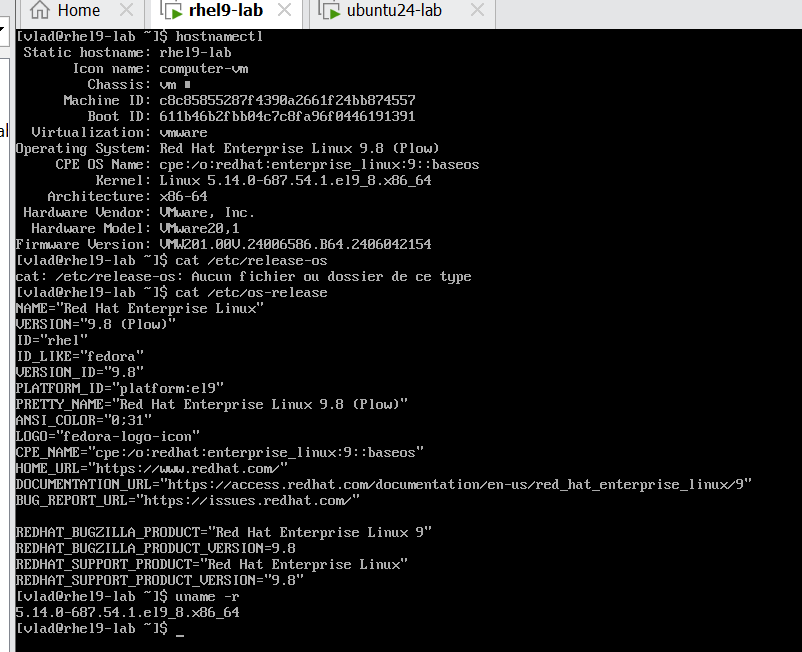

Figure 14 - hostnamectl, /etc/os-release et uname -r identifient RHEL 9.8 et son noyau. (C2)

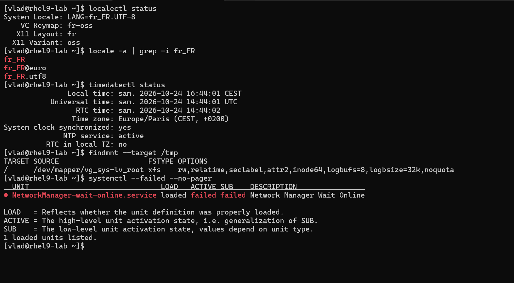

Figure 15 - Locale française et NTP actifs. NetworkManager-wait-online.service est en échec. (C2-C3/E)

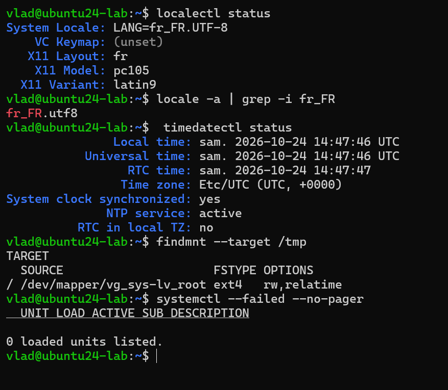

Figure 16 - Locale française et NTP actifs ; fuseau Etc/UTC et /tmp encore inclus dans la racine. Aucune unité en échec. (C2-C3/E)

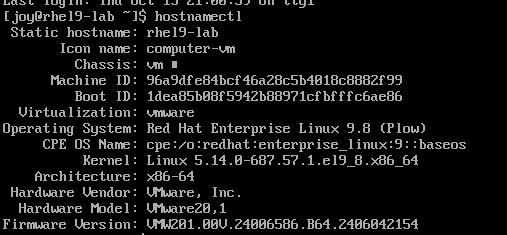

Figure 17 - hostnamectl identifie rhel9-lab, RHEL 9.8 et le noyau 5.14.0-687.57.1.el9_8. (C2)

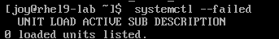

Figure 18 - Le relevé systemctl --failed affiche zéro unité. (C2)

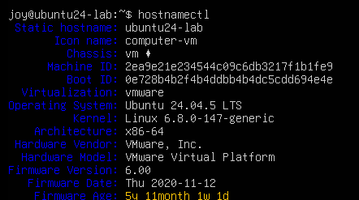

Figure 19 - hostnamectl identifie Ubuntu 24.04.5 LTS sur ubuntu24-lab. (C2)

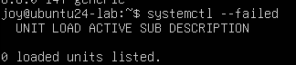

Figure 20 - Le relevé systemctl --failed affiche zéro unité. (C2)

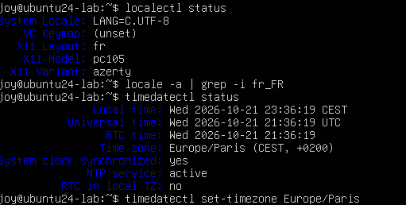

Figure 21 - Europe/Paris et NTP sont actifs. LANG=C.UTF-8 et aucune locale fr_FR n’est affichée. (C3)

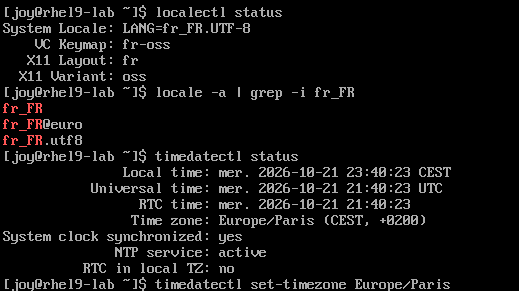

Figure 22 - Locale française disponible, fuseau Europe/Paris et horloge synchronisée. (C3)


## 5 Mises à jour et dépôts

### C4 Commandes et historiques

```bash
# RHEL
sudo dnf -y update
sudo dnf history
sudo dnf history info last
sudo dnf repolist

# Ubuntu
sudo apt update
sudo apt -y full-upgrade
apt list --upgradable
sudo tail -80 /var/log/apt/history.log
```

Sur RHEL, l'accès à EPEL reste conditionné à sa disponibilité dans l'environnement de laboratoire et aux dépôts autorisés. L'abonnement ou les dépôts doivent d'abord permettre les mises à jour normales. Aucun résultat d'activation EPEL n'apparaît dans les preuves.

| Environnement | Observation conservée | Contrôle à terminer |
|---|---|---|
| RHEL A | Le 25 octobre, dnf check-update liste des mises à jour et retourne 100, dont le noyau 5.14.0-687.60.1.el9_8 ; le noyau actif reste le .54. | Appliquer la mise à jour, conserver sa transaction et contrôler le noyau après redémarrage. |
| Ubuntu A | Le noyau actif est 6.8.0-147-generic au 25 octobre. La liste APT contient encore 13 paquets pouvant être mis à jour. | Exécuter full-upgrade puis refaire la liste et l'historique. |
| RHEL B | Transaction update réussie le 22 octobre à 09:23 ; un noyau .59 est installé, tandis que hostnamectl montre le .57. | Redémarrer puis contrôler uname -r et les unités en échec. |
| Ubuntu B | Historique APT présent ; une capture montre encore 14 paquets disponibles. | Conserver l'état après application de toutes les mises à jour. |

`apt update` actualise le catalogue des paquets. `apt full-upgrade` applique les mises à jour. Une transaction d'installation de nano ou des outils C ne prouve pas à elle seule que toute la distribution est à jour. Après installation d'un nouveau noyau, un redémarrage suivi de uname -r confirme le noyau réellement utilisé.

### Extraits d’historique horodatés

RHEL B, transaction DNF relevée le 22 octobre :

```text
5 | -y update | 2026-10-22 09:23 | I, U | 14
```

L’identifiant 5, l’opération update, l’horodatage et le nombre 14 sont repris de l’historique ; les espacements de colonne sont normalisés. Le détail des paquets figure dans tp01/preuves/env-b/rhel9-lab.txt. Les historiques APT complets sont conservés dans les fichiers Ubuntu correspondants.

Ubuntu A, mise à jour automatique du 22 octobre :

```text
Start-Date: 2026-10-22  12:47:03
Commandline: /usr/bin/unattended-upgrade
Upgrade: libnss3:amd64 (2:3.98-1ubuntu0.2, 2:3.98-1ubuntu0.3)
End-Date: 2026-10-22  12:47:03
```

Cette transaction confirme une mise à jour appliquée ; elle ne suffit pas à conclure que tous les paquets sont à jour au dernier relevé.

### Captures

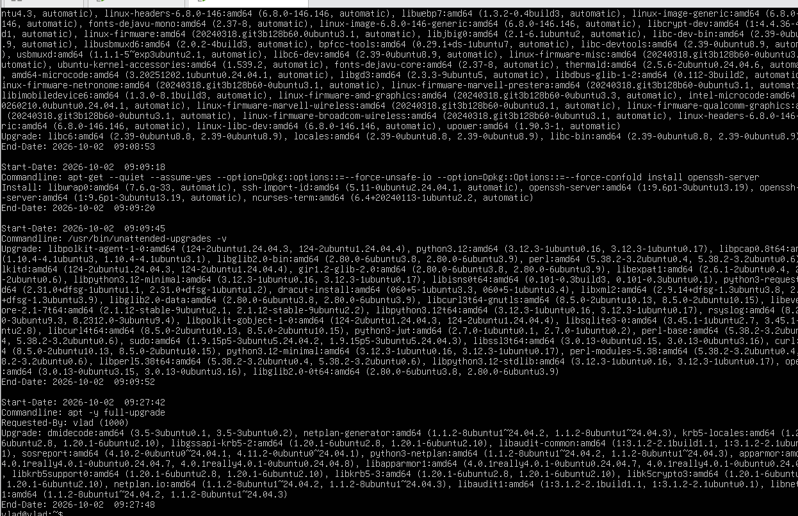

Figure 23 - Extrait d’historique de transactions. Les relevés récents signalent encore des mises à jour disponibles. (C4)

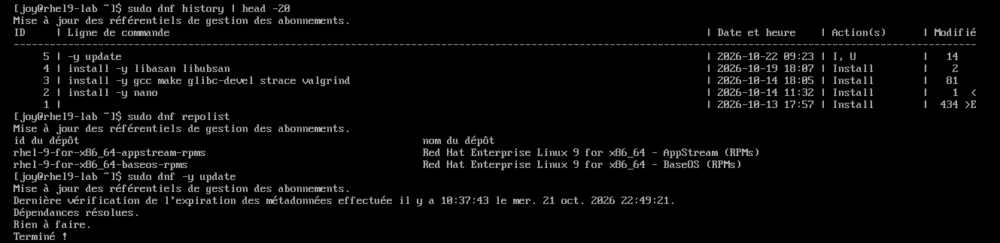

Figure 24 - Transaction update datée du 22 octobre à 09:23 ; dépôts BaseOS et AppStream présents. (C4)

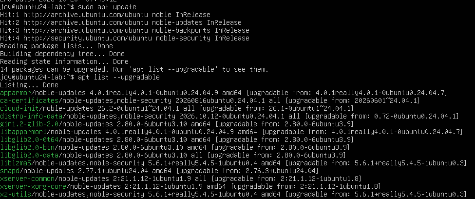

Figure 25 - apt update actualise le catalogue. La liste contient 14 paquets pouvant encore être mis à jour. (C4)

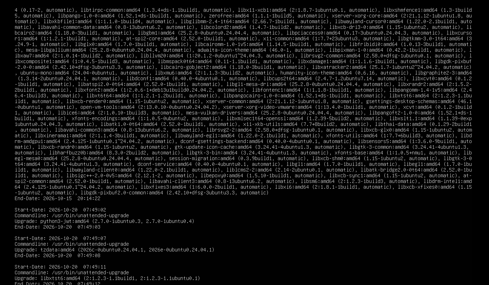

Figure 26 - Historique des installations et mises à jour automatiques. Les fichiers texte permettent sa lecture complète. (C4)


## 6 Comptes et accès distant

### D2 Comptes nominatifs et délégation

L’administration passe par un compte personnel, puis par sudo. Les groupes utilisés sont wheel sur RHEL et sudo sur Ubuntu. Un compte doit être disponible pour chacun des trois membres sur chaque serveur.

| Membre | Identifiant prévu pour la reconstruction |
|---|---|
| TETA KENGNE Joy Adjovi | joy |
| Vladimir MELTSOV | vlad |
| Mankchould LAWAL | mankchould |

Dans les résultats A, vlad appartient au groupe d’administration et sudo id retourne uid=0(root) sur les deux VM. Les relevés B montrent alice dans wheel sur RHEL et dans sudo sur Ubuntu, ainsi qu’un compte joy sur Ubuntu. L’accès de mankchould reste à vérifier sur chaque serveur. Les identifiants historiques sont conservés dans les preuves.

Pour créer un compte absent, renseigner son identifiant et son nom. Exemple pour Mankchould LAWAL :

```bash
compte=mankchould
nom='Mankchould LAWAL'

# RHEL : uniquement si le compte n'existe pas encore
sudo useradd -m -c "$nom" "$compte"
sudo passwd "$compte"
sudo usermod -aG wheel "$compte"
sudo chage -l "$compte"

# Ubuntu : uniquement si le compte n'existe pas encore
sudo adduser --gecos "$nom" "$compte"
sudo usermod -aG sudo "$compte"
```

Appliquer la branche correspondant à la distribution. Pour un compte déjà présent, vérifier son identité avec getent passwd et ses groupes avec id. Les mots de passe sont individuels. Après ajout au groupe d’administration, ouvrir une nouvelle session et tester :

```bash
id
sudo -l
sudo id
```

La session déjà ouverte conserve ses anciens groupes ; la reconnexion rend la nouvelle appartenance effective. Aucun compte supplémentaire ne reçoit l’UID 0.

### D1 Verrouillage du mot de passe root

```bash
sudo passwd -l root
sudo passwd -S root
```

Les relevés affichent L ou LK. Ce verrouillage concerne le mot de passe ; l’interdiction de connexion SSH root se règle aussi dans sshd.

### D3 Connexion par clé

Chaque membre crée une clé de laboratoire sur son poste Windows. La clé privée reste sur ce poste. Si le fichier existe, le réutiliser ou choisir un autre nom. Copier seulement la clé publique sur le compte correspondant :

```powershell
ssh-keygen -t ed25519 -a 100 -f "$env:USERPROFILE\.ssh\id_ed25519_tp01"
$Ip = '192.168.198.128'
$Compte = 'vlad'
$Preparation = 'umask 077; mkdir -p ~/.ssh; cat >> ~/.ssh/authorized_keys'
$Droits = 'chmod 700 ~/.ssh; chmod 600 ~/.ssh/authorized_keys'
Get-Content "$env:USERPROFILE\.ssh\id_ed25519_tp01.pub" |
  ssh "$Compte@$Ip" "$Preparation; $Droits"
ssh -t -i "$env:USERPROFILE\.ssh\id_ed25519_tp01" `
  -o PreferredAuthentications=publickey -o PasswordAuthentication=no `
  -o KbdInteractiveAuthentication=no "$Compte@$Ip" 'id; sudo -l; sudo id'
```

Répéter pour Ubuntu et chaque membre avec ses paramètres. La passphrase protège la clé privée ; sudo peut demander le mot de passe du compte après connexion.

**Résultats.** Les deux tests A du 25 octobre imposent l’authentification par clé et retournent le code 0. La délégation est confirmée sur les deux VM. Sur B, la connexion RHEL avec clé est visible. L’essai Ubuntu comporte PubkeyAuthentication=no et établit donc une connexion par mot de passe ; il ne vérifie pas la clé.

### D4 Configuration SSH et refus root

Conserver la première session ouverte pendant le réglage. Sauvegarder la configuration, rendre PermitRootLogin no effectif, puis valider la syntaxe avant de recharger le service :

```bash
sudo cp -a /etc/ssh/sshd_config /etc/ssh/sshd_config.tp01.bak
sudoedit /etc/ssh/sshd_config
# Directive a definir : PermitRootLogin no
sudo /usr/sbin/sshd -t
sudo /usr/sbin/sshd -T
# RHEL
sudo systemctl reload sshd
# Ubuntu
sudo systemctl reload ssh
```

Tenir compte des fichiers inclus et des blocs Match. Tester ensuite depuis Windows :

```powershell
ssh -o BatchMode=yes root@192.168.198.128 true
ssh -o BatchMode=yes root@192.168.198.129 true
```

**Résultats.** PermitRootLogin no apparaît dans les exports A et les textes B du 22 octobre. Les deux tests A retournent 255 avec Permission denied. Les captures B montrent aussi un refus d’authentification. Une expiration réseau ne validerait pas ce test. PasswordAuthentication yes reste présent : la consigne D4 reporte la désactivation globale des mots de passe au TP6, après généralisation et test des clés.

### Captures

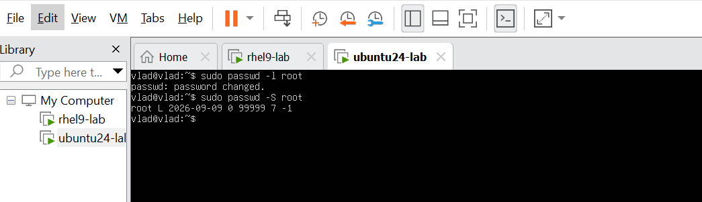

Figure 27 - passwd -S root affiche le statut L. Le blocage SSH fait l’objet d’un test distinct. (D1)

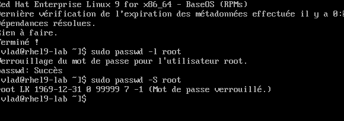

Figure 28 - passwd -S root affiche LK ; le compte ne dispose plus d’un mot de passe utilisable. (D1)

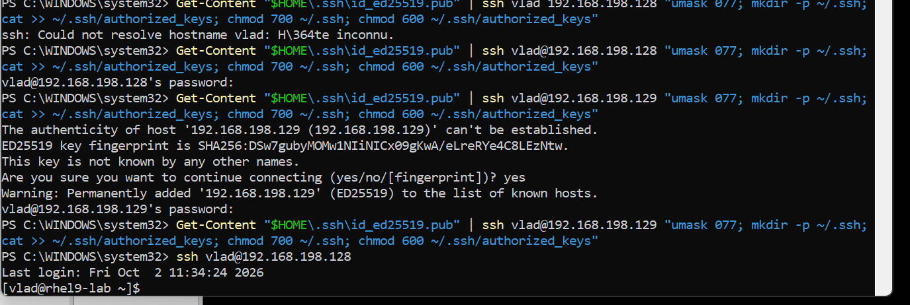

Figure 29 - Une première erreur de syntaxe est suivie de la copie de la clé publique vers les deux adresses NAT. (D3)

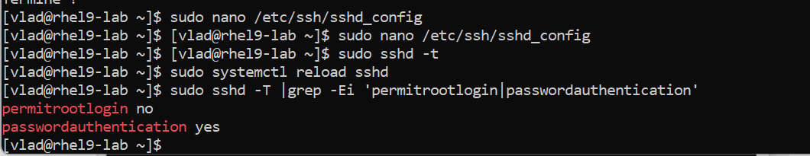

Figure 30 - Validation de syntaxe, rechargement et valeur effective permitrootlogin no. (D4)

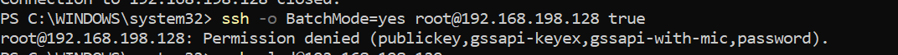

Figure 31 - Le test distant retourne Permission denied ; la machine répond au client SSH. (D4)

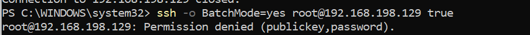

Figure 32 - Refus explicite de l’authentification directe du compte root. (D4)

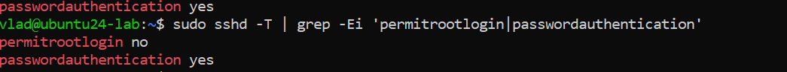

Figure 33 - permitrootlogin no est affiché par sshd -T ; l’authentification par mot de passe reste activée globalement. (D4)

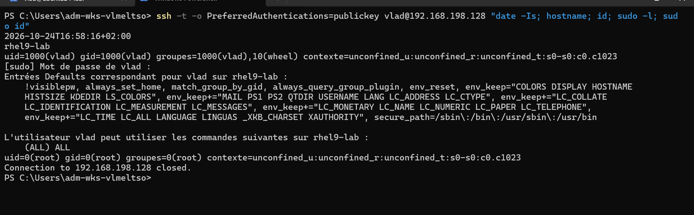

Figure 34 - Test daté avec PreferredAuthentications=publickey ; sudo -l et sudo id confirment la délégation. (D2-D3)

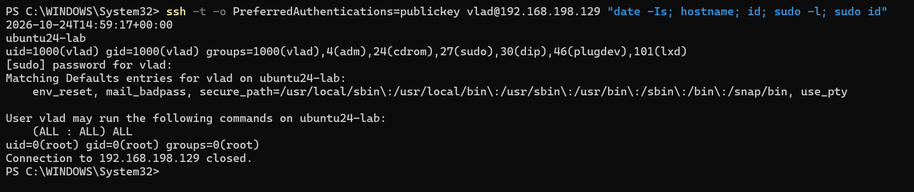

Figure 35 - Test daté avec authentification par clé imposée ; sudo id retourne uid=0. (D2-D3)

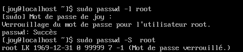

Figure 36 - Le statut LK confirme le verrouillage du mot de passe root. (D1)

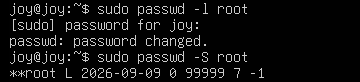

Figure 37 - Le statut L confirme le verrouillage du mot de passe root. (D1)

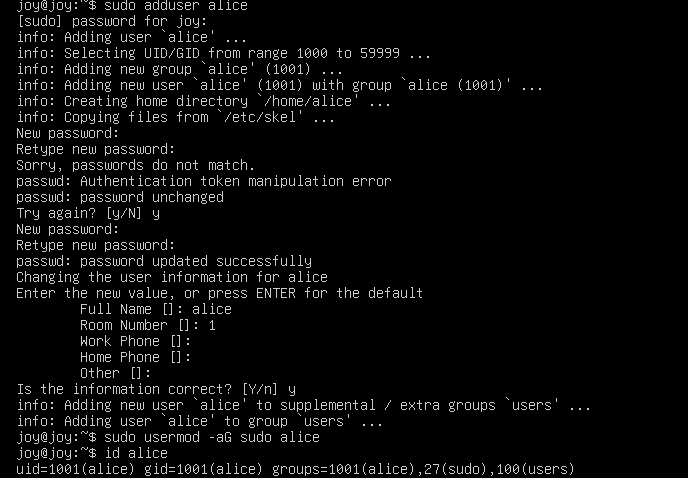

Figure 38 - Création d’alice, correction de la confirmation du mot de passe puis ajout au groupe sudo. (D2)

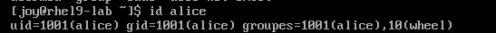

Figure 39 - id alice confirme le groupe d’administration wheel. (D2)

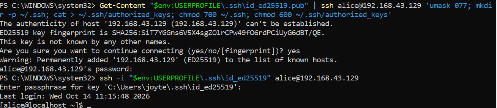

Figure 40 - Connexion SSH avec un fichier de clé privée et demande de sa passphrase. (D3)

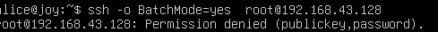

Figure 41 - Refus d’authentification réel lors du test distant ; à rapprocher de la configuration effective datée. (D4)

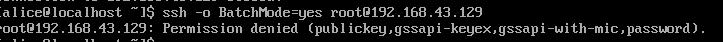

Figure 42 - Le test depuis un autre système retourne Permission denied. (D4)


## 7 Pare-feu et réseau du laboratoire

### D5 État observé

UFW est actif sur les deux Ubuntu et autorise OpenSSH en IPv4 et IPv6, avec refus des autres connexions entrantes par défaut. Les RHEL ont firewalld actif mais leur zone public autorise aussi cockpit et dhcpv6-client. Pour ce laboratoire administré en SSH sur IPv4, ne conserver que les ouvertures nécessaires et refaire une connexion après chaque modification.

```bash
# RHEL : appliquer dans la zone active affichee par --get-active-zones
sudo firewall-cmd --get-active-zones
sudo firewall-cmd --permanent --zone=public --add-service=ssh
sudo firewall-cmd --permanent --zone=public --remove-service=cockpit
sudo firewall-cmd --reload
sudo firewall-cmd --zone=public --list-all

# Ubuntu
sudo ufw allow OpenSSH
sudo ufw enable
sudo ufw status verbose
```

Examiner également dhcpv6-client : le retirer seulement si le laboratoire n’utilise pas DHCPv6. Vérifier ensuite l'accès depuis Windows avec le compte nominatif et l'authentification par clé. Les tests récents de l’environnement A démontrent cet accès depuis le poste d'administration ; toute modification ultérieure du pare-feu nécessite un nouveau test.

### Adresses du réseau interne

Sur le RHEL de l’environnement A, ens192 est active mais sans IPv4. Sur son Ubuntu, ens34 est inactive. Identifier d'abord les profils et les journaux. Le défaut de démarrage NetworkManager-wait-online est compatible avec une attente réseau, mais sa cause précise doit être confirmée, sans conclure sur la seule ligne d'échec.

```bash
# Diagnostic RHEL
nmcli device status
nmcli connection show
sudo journalctl -b -u NetworkManager-wait-online --no-pager
sudo journalctl -b -u NetworkManager --no-pager
```

Configurer le profil de la carte de laboratoire en IPv4 manuelle, sans passerelle par défaut, sur 10.42.0.11/24. Sur une nouvelle VM sans profil correspondant, l'exemple suivant crée ce profil ; s'il existe déjà, le modifier plutôt que le dupliquer.

```bash
sudo nmcli connection add type ethernet ifname ens192 con-name lab-interne \
  ipv4.method manual ipv4.addresses 10.42.0.11/24 \
  ipv4.never-default yes ipv6.method disabled
sudo nmcli connection up lab-interne
ip -br a
ip route
```

Sur Ubuntu, intégrer la carte de laboratoire dans la configuration Netplan existante. Exemple de contenu d'un fichier /etc/netplan/90-tp01-lab.yaml pour l'interface ens34 de l’environnement A, en conservant la configuration de la carte NAT :

```yaml
network:
  version: 2
  ethernets:
    ens34:
      dhcp4: false
      addresses: [10.42.0.12/24]
      optional: true
```

```bash
sudo chmod 600 /etc/netplan/90-tp01-lab.yaml
sudo netplan generate
sudo netplan try
ip -br a
ip route
# Depuis RHEL : ping -c 3 10.42.0.12
# Depuis Ubuntu : ping -c 3 10.42.0.11
```

Conserver la console VMware accessible pendant ces réglages. La route par défaut reste sur le NAT. Après correction de la cause de l'attente réseau, redémarrer et vérifier systemctl --failed ; effacer seulement un état failed ne constitue pas une réparation.

### Captures

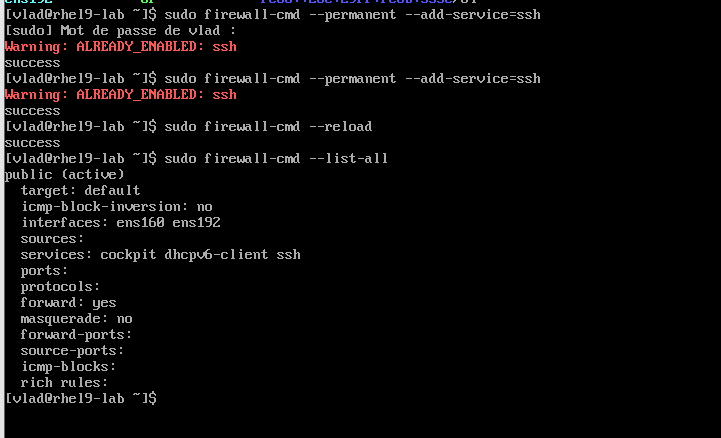

Figure 43 - SSH est autorisé ; cockpit et dhcpv6-client figurent aussi dans la zone public. (D5)

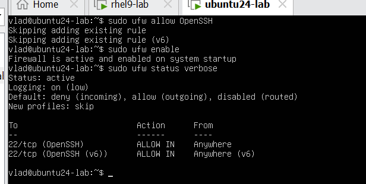

Figure 44 - UFW est actif, refuse les entrées par défaut et autorise OpenSSH en IPv4 et IPv6. (D5)

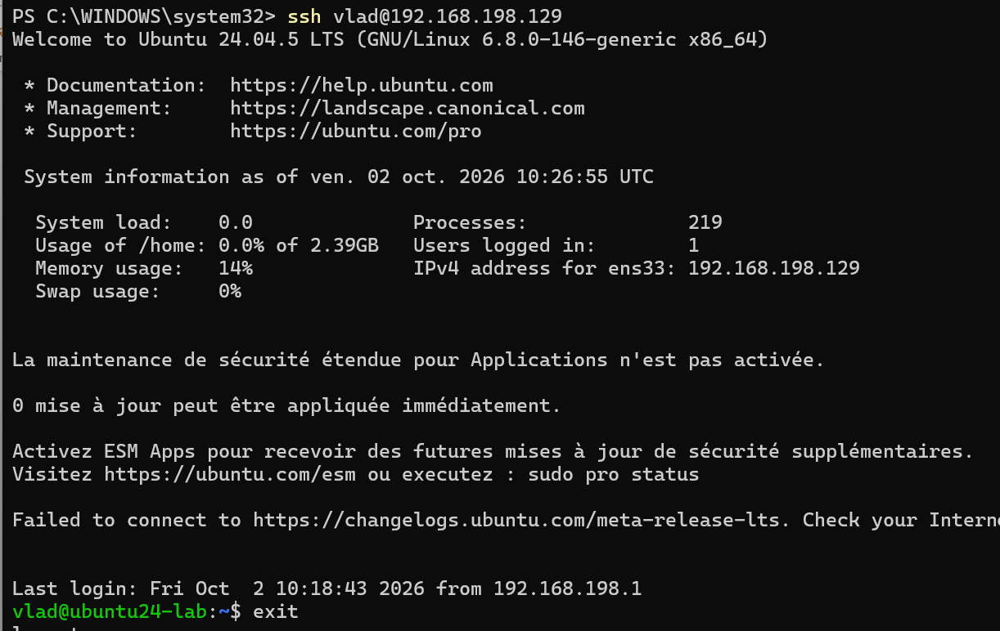

Figure 45 - Ouverture d’une session SSH après activation du filtrage. (D5)

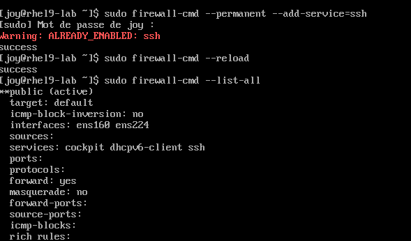

Figure 46 - La zone public autorise ssh, cockpit et dhcpv6-client sur les interfaces affichées. (D5)

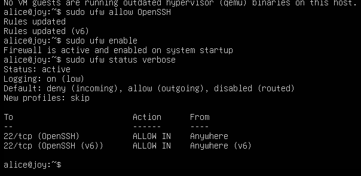

Figure 47 - Règles OpenSSH en IPv4 et IPv6, refus des autres entrées par défaut. (D5)


## 8 Écarts entre les distributions

### C5 Tableau comparatif complet

| Opération | RHEL 9 | Ubuntu 24.04 | Raison ou point de contrôle |
|---|---|---|---|
| Installateur | Anaconda, profil minimal | Subiquity, Ubuntu Server minimal | Interfaces et formats d'installation différents |
| Installation automatisée | Kickstart | Autoinstall | Formats propres à chaque installateur ; bonus du TP |
| Paquets | RPM, dnf | DEB, apt | Formats et gestionnaires différents |
| Actualiser le système | sudo dnf -y update | sudo apt update puis sudo apt -y full-upgrade | APT sépare catalogue et application des mises à jour |
| Historique | sudo dnf history ; sudo dnf history info last | sudo tail -80 /var/log/apt/history.log | Base des transactions DNF contre journal APT |
| Dépôts | sudo dnf repolist | Sources APT dans /etc/apt/sources.list.d/ | Configuration de dépôts propre à la distribution |
| Nom d'hôte | hostnamectl set-hostname rhel9-lab | hostnamectl set-hostname ubuntu24-lab | Même outil systemd ; nom différent |
| Identité et noyau | hostnamectl ; cat /etc/os-release ; uname -r | Mêmes commandes | Relever les versions réellement installées |
| Échecs de services | systemctl --failed --no-pager | Même commande | Contrôle des unités en échec après redémarrage |
| Groupe administrateur | wheel | sudo | Délégation prévue par la distribution |
| Créer un compte | useradd -m puis passwd | adduser | Assistants de création différents |
| Locale française | glibc-langpack-fr ; localectl set-locale | locale-gen ; update-locale | Mécanismes de génération et de sélection différents |
| Vérifier la locale | localectl status ; locale -a | Mêmes commandes | Disponibilité et valeur par défaut sont deux contrôles distincts |
| Fuseau et NTP | timedatectl status | Même commande | Europe/Paris et synchronisation active |
| Système de fichiers | XFS sur les LV observés | ext4 sur les LV observés | Choix retenus dans les installations |
| /tmp | Répertoire de la racine dans le relevé | tmpfs de 512 Mio demandé | Exigence particulière d'Ubuntu dans ce TP |
| Service SSH | sshd | ssh | Noms d'unités de service différents |
| Syntaxe SSH | sudo /usr/sbin/sshd -t | Même commande | Aucun message en cas de syntaxe valide |
| Configuration SSH | sudo /usr/sbin/sshd -T | Même commande | Contrôler la valeur effective, pas seulement le fichier édité |
| Pare-feu | firewalld, firewall-cmd | ufw | Outils et modèles de règles différents |
| Configuration réseau | NetworkManager, nmcli | Netplan et son renderer existant | Identifier les interfaces de chaque VM |
| Agrandir un système de fichiers | xfs_growfs sur le point de montage | resize2fs sur le périphérique ext4 | Étendre d'abord le LV et vérifier la réserve |

## 9 Incidents et résultats des vérifications

### Incidents rencontrés

| Incident | Diagnostic et correction | Résultat |
|---|---|---|
| Script PowerShell bloqué comme non signé | Déblocage du fichier téléchargé avec Unblock-File, puis relance du collecteur | La copie vers les VM démarre ensuite |
| SSH expire lors de la première collecte | Les VM sont arrêtées ; mise sous tension depuis VMware | Les mêmes adresses NAT deviennent joignables |
| Copie de clé : Could not resolve hostname ssh | Syntaxe de la ligne PowerShell reprise avec Get-Content et un tube vers ssh | Les tests par clé A réussissent ensuite |
| Confirmation du mot de passe sur Ubuntu B | Les deux saisies diffèrent ; saisie recommencée | password updated successfully, puis ajout au groupe sudo |
| Fichier de clé SCP introuvable sur B | Le chemin id_ed25519_tp01 ne correspond pas au fichier id_ed25519 présent | Chemin identifié ; transfert final non consigné |
| NetworkManager-wait-online sur RHEL A | Échec observé ; diagnostic du profil et des journaux décrit en section 7 | L’échec figure encore dans le dernier contrôle |

### Résultats

Les huit exports directs A sont datés du 25 octobre. Ils comprennent l’état système, lsblk, les contrôles locaux et les accès SSH pour chaque VM. Les textes B reprennent les relevés datés du 22 octobre conservés dans le compte rendu d’installation.

| Vérification | Environnement A | Environnement B |
|---|---|---|
| Volumes, swap et journaux | Cinq LV ; swap 2 Gio ; /var/log séparé sur les deux VM | Cinq LV ; swap 2 Gio ; /var/log séparé |
| Réserve vg_sys | RHEL 5 Gio ; Ubuntu moins de 2 Gio | RHEL 0 ; Ubuntu moins de 3 Gio |
| Réseau interne | Pas d’IPv4 sur ens192/ens34 ; échanges non validés | 10.42.0.11 et 10.42.0.12 apparaissent dans les relevés |
| Locale et heure | fr_FR et NTP actifs ; Ubuntu affiche UTC | NTP et Europe/Paris ; fr_FR non démontrée sur Ubuntu |
| /tmp Ubuntu | Dans la racine ext4 | tmpfs 512 Mio |
| Unités en échec | Ubuntu : aucune ; RHEL : attente réseau en échec | Aucune dans les relevés |
| Paquets | DNF : mises à jour disponibles ; APT : 13 paquets listés | Transaction DNF update présente ; APT : 14 paquets listés |
| Root, clé et sudo | Root verrouillé/refusé ; clé et sudo vlad validés | Root verrouillé/refusé ; clé RHEL visible ; clé Ubuntu à vérifier |
| Pare-feu | Actifs ; OpenSSH sur Ubuntu ; cockpit encore ouvert sur RHEL | Même constat |

Sur RHEL A, le relevé de 11:07 n’affiche aucune unité en échec ; le contrôle de 11:08 signale ensuite NetworkManager-wait-online. Le tableau retient le dernier état. Les codes 2 de getent pour un groupe absent de la distribution ne sont pas des échecs de sudo. De même, le code 100 de dnf check-update signifie que des mises à jour sont disponibles.

## 10 Reconstruction rapide

### Séquence à suivre

**1 Préparer VMware.** Recréer les ressources et les disques du tableau de l'environnement choisi. Configurer NAT et réseau interne isolé. Attacher l'ISO, vérifier son empreinte si une référence est disponible, puis prendre avant-installation.

**2 Installer et partitionner.** Choisir l'installation serveur minimale. Créer les partitions d'amorçage et le groupe vg_sys ; appliquer les noms, tailles, types et points de montage du tableau de l’environnement concerné. Créer les comptes nominatifs. Retirer l'ISO après installation.

**3 Régler l'identité.** Sur RHEL, utiliser la première commande ; sur Ubuntu, la seconde. Choisir la locale et Europe/Paris, puis vérifier la synchronisation.

```bash
# RHEL
sudo hostnamectl set-hostname rhel9-lab
# Ubuntu
sudo hostnamectl set-hostname ubuntu24-lab
# Les deux
sudo timedatectl set-timezone Europe/Paris
hostnamectl
timedatectl status
```

**4 Configurer le réseau interne.** Relever les noms réels des interfaces. Attribuer 10.42.0.11/24 à RHEL et 10.42.0.12/24 à Ubuntu sur le laboratoire isolé. Garder la route par défaut sur le NAT. Vérifier les échanges et les dépôts.

**5 Mettre à jour.** Corriger d'abord toute indisponibilité des dépôts RHEL. Exécuter les commandes DNF ou APT de la section 5, puis conserver leur historique. Redémarrer si un nouveau noyau ou un composant système le nécessite et contrôler uname -r.

**6 Préparer les accès.** Attribuer wheel ou sudo aux comptes personnels ; se reconnecter. Copier les clés publiques et tester chaque compte. Conserver une session initiale ouverte. Verrouiller le mot de passe root, rendre PermitRootLogin no effectif, valider la syntaxe et recharger SSH.

**7 Activer le pare-feu.** Autoriser SSH avant activation. Supprimer les ouvertures inutiles dans la zone active de firewalld. Vérifier une nouvelle connexion par clé depuis Windows après application.

**8 Configurer /tmp sur Ubuntu.** Ajouter l'entrée tmpfs de 512 Mio une seule fois dans fstab, vérifier sa cohérence puis contrôler le montage après redémarrage.

**9 Contrôler et collecter.** Comparer lsblk avec le tableau, vérifier vgs, la swap, l'horloge, l'absence d'unités en échec, sudo, root et le pare-feu. Exécuter le collecteur sur les quatre VM. Comparer les nouveaux résultats au tableau de la section 9 et conserver les sorties datées.

**10 Relire et déposer.** Faire relire INSTALL.md par un autre groupe, noter ses deux remarques et les modifications réalisées, vérifier les membres du groupe dans README.md et renseigner le temps passé dans le journal. Déposer le rapport, INSTALL.md, les preuves et le journal dans le dépôt du groupe indiqué sur Myges avant la séance suivante.

```bash
git status
git add .
git commit -m "TP1 installation et durcissement Linux"
git push
```

La première page du sujet précise le dépôt Myges du groupe pour le rendu officiel. Un dépôt GitHub personnel peut servir de copie de travail. La procédure de création ou de clonage et de push figure dans docs/depot-git.md. Les fichiers Kickstart et autoinstall correspondent au bonus facultatif ; ce dossier ne revendique pas ce bonus.

